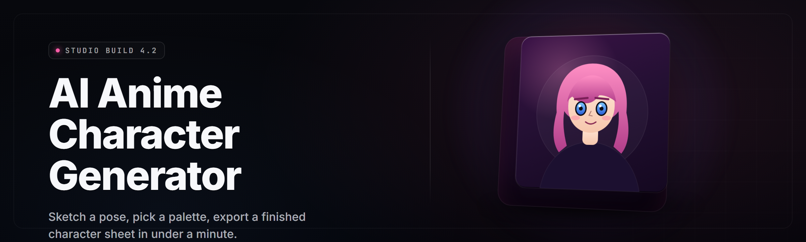

  
  
  

  

  
  

---

  

**Forge original anime characters from a text prompt, a reference sheet, or a single seed. Local diffusion pipeline, LoRA merging, tag-aware prompt builder, and a character bible exporter — all in one `.exe`. No install, no Python, no cloud account.**

---

## 📚 Table of Contents

- [Overview](#-overview)
- [What is anime-character-forge](#-what-is-anime-character-forge)
- [The Problem](#-the-problem)
- [The Solution](#-the-solution)
- [Key Features](#-key-features)
- [Character Generation Modules](#-character-generation-modules)
- [Prompt & Tag Engine](#-prompt--tag-engine)
- [Style & LoRA Modules](#-style--lora-modules)
- [Export & Pipeline Modules](#-export--pipeline-modules)
- [System Requirements](#-system-requirements)
- [Compatibility](#-compatibility)
- [Quick Start](#-quick-start)
- [Installation](#-installation)
- [All Modules Status](#-all-modules-status)
- [Usage Guidelines](#-usage-guidelines)
- [Tips for Best Results](#-tips-for-best-results)
- [Known Issues](#-known-issues)
- [FAQ](#-faq)

---

## 🎨 Overview

| Category | Details |
|---|---|
| Product | anime-character-forge |
| Type | Windows desktop application (`.exe`) |
| Version | v2.4.1 (2026 release line) |
| Runtime | Bundled — no external dependencies |
| Primary Use | Generate, refine, and export original anime characters |
| Output Formats | PNG, WebP, PSD-layered, JSON character card, TXT prompt |
| Model Support | SD 1.5, SDXL, Pony, Illustrious, NoobAI, custom checkpoints |
| Distribution | Direct download → extract → run |

anime-character-forge is a self-contained AI anime character generator built for artists, writers, VTuber preppers, and tabletop players who need consistent original characters on demand. It pairs a local diffusion backend with a tag-aware prompt compiler, a LoRA stacker, and a character bible exporter so the same face, outfit, and vibe survive across dozens of generations.

---

## 📖 What is anime-character-forge

| Term | Explanation |
|---|---|
| Character Card | A reusable JSON blob describing a character's tags, palette, LoRA weights, and seed |
| Tag Compiler | The engine that turns plain English into booru-style comma tags |
| LoRA Stacker | Merges up to 6 LoRA files with per-slot weight control |
| Seed Lock | Fixes the latent seed so pose varies but identity stays |
| Character Bible | Exported folder with PNGs, prompt history, and a Markdown sheet |
| Refine Pass | A second low-denoise pass that cleans line art and eyes |
| Face Anchor | Embedding that pins facial structure across generations |

- Generate a full character sheet from a one-line prompt in under 30 seconds on a mid-range GPU.
- Lock identity across poses, outfits, and expressions without retraining.
- Export production-ready files for comics, VTuber avatars, and game sprites.
- Everything runs offline — your prompts and outputs never leave the machine.
- Works with the checkpoints you already have; no vendor lock-in.

---

## 🩹 The Problem

- Most AI anime generators live behind a subscription and watermark your output.
- Identity drifts across generations — the same prompt gives a slightly different face every time.
- Booru tagging syntax is a wall for anyone who isn't already deep in the community.
- LoRA stacking is manual, fiddly, and breaks when weights collide.
- Cloud tools rate-limit you the moment you actually need volume.
- Exporting a consistent character sheet means stitching files by hand in three other apps.
- Offline workflows force you to juggle ComfyUI graphs, Python venvs, and broken CUDA wheels.

---

## 🧪 The Solution

| Problem | Solution |
|---|---|
| Subscription paywalls | Fully offline `.exe`, no account, no watermark |
| Identity drift | Seed Lock + Face Anchor + character cards |
| Tag syntax barrier | Plain-English Tag Compiler with live preview |
| Manual LoRA juggling | LoRA Stacker with 6 slots and weight presets |
| Cloud rate limits | Local GPU queue, batch up to 500 generations |
| Scattered exports | One-click Character Bible export |
| Python/CUDA setup pain | Bundled runtime, single `.exe` |

---

## ⭐ Key Features

| Feature | Description | Benefit |
|---|---|---|
| One-Line Character Forge | Describe a character in English, get a sheet | Zero learning curve |
| Tag Compiler | English → booru tags with live preview | Skip the syntax wall |
| Seed Lock | Freeze identity across poses | Consistent characters |
| Face Anchor | Embedding-based facial pinning | No retraining needed |
| LoRA Stacker | 6-slot merge with weight sliders | Full style control |
| Character Cards | JSON save/load of full character state | Reusable characters |
| Batch Queue | Up to 500 generations queued | Volume work |
| Refine Pass | Low-denoise cleanup for line art | Production quality |
| Expression Grid | Auto-generates 9 emotion variants | Sheet-ready output |
| Outfit Swap | Re-render same character in new outfits | Wardrobe system |
| PSD Export | Layered export for editing | Pro workflow |
| Character Bible | Folder + Markdown sheet export | Ready to publish |

---

## 🧬 Character Generation Modules

### **Identity & Consistency**

| Feature | Effect |
|---|---|
| Seed Lock | Pins latent seed across renders |
| Face Anchor Embedding | Stabilizes facial structure |
| Identity Drift Guard | Warns when a render falls outside tolerance |
| Reference Sheet Import | Pulls identity from an uploaded sheet |
| Multi-Seed Probe | Renders 6 candidates side by side |
| Consistency Score | 0–100 rating against the anchor |

### **Pose & Composition**

| Feature | Effect |
|---|---|
| Pose Preset Library | 48 built-in anime poses |
| Skeleton Control | OpenPose-style bone editing |
| Framing Presets | Bust, half-body, full-body, chibi |
| Camera Angle Slider | Low, eye-level, high angle |
| Dynamic Motion Flag | Adds action-line energy |
| Group Scene Mode | Two-character compositions |

### **Expression & Emotion**

| Feature | Effect |
|---|---|
| Expression Grid | 9 emotions in one batch |
| Blend Weight | Mix two expressions per render |
| Blush / Sweat / Tears | Per-feature toggle |
| Eye Highlight Pass | Refine pass for iris detail |
| Mouth Shape Library | 24 mouth presets |
| Emotion Presets | Tsundere, kuudere, genki, stoic |

---

## 🏷️ Prompt & Tag Engine

### **Tag Compiler**

| Feature | Effect |
|---|---|
| English → Tags | Converts plain prose to booru syntax |
| Live Preview | Shows compiled tags before render |
| Tag Autocomplete | 12k-tag dictionary |
| Negative Presets | Anti-deform, anti-badhands, anti-extra-limbs |
| Weight Syntax | `(tag:1.3)` support with slider UI |
| Tag History | Reusable snippet library |

### **Prompt Workbench**

| Feature | Effect |
|---|---|
| Prompt Versioning | Save/compare prompt variants |
| A/B Render | Two prompts, one batch, side by side |
| Prompt Randomizer | Wildcard-driven variation |
| Seed Walk | Increments seed across a batch |
| Prompt Diff | Highlight changes between versions |
| Export to TXT | Plain prompt export for sharing |

---

## 🎴 Style & LoRA Modules

### **Style Control**

| Feature | Effect |
|---|---|
| Style Presets | 32 anime art styles |
| Line Weight Slider | Sketchy → clean vector |
| Palette Lock | Fix a character's color story |
| Shading Mode | Cel, soft, painterly |
| Era Presets | 90s, 2000s, modern, webtoon |
| Studio Emulation | Style-matched without named studios |

### **LoRA Stacker**

| Feature | Effect |
|---|---|
| 6-Slot Merge | Stack up to six LoRAs |
| Per-Slot Weight | 0.0–1.5 range sliders |
| Conflict Detector | Flags weight collisions |
| Preset Save | Store merge recipes |
| Auto-Weight | Suggests weights from LoRA metadata |
| Hot Reload | Swap LoRAs mid-session |

---

## 📦 Export & Pipeline Modules

### **Export**

| Feature | Effect |
|---|---|
| PNG / WebP | Standard image export |
| PSD Layered | Line art, flat, shade, highlight |
| Character Card JSON | Full character state |
| Bible Folder | PNGs + prompts + Markdown sheet |
| Sprite Sheet | 4×4 grid for game use |
| VTuber Prep | Transparent-background bust export |

### **Pipeline**

| Feature | Effect |
|---|---|
| Batch Queue | 500-item local queue |
| Watch Folder | Auto-render on new prompt files |
| CLI Mode | Headless render for scripts |
| Auto-Refine | Chains a refine pass after render |
| GPU Scheduler | VRAM-aware batching |
| Log Export | Per-render metadata log |

---

## 🖥️ System Requirements

| Component | Minimum | Recommended |
|---|---|---|
| OS | Windows 10 64-bit (21H2+) | Windows 11 64-bit |
| CPU | 4-core x86-64 | 8-core x86-64 |
| RAM | 8 GB | 16 GB |
| GPU | NVIDIA GTX 1060 6 GB | NVIDIA RTX 3060 12 GB+ |
| VRAM | 6 GB | 12 GB |
| DirectX | 12 | 12 |
| Disk | 12 GB free | 30 GB SSD |
| Runtime | Bundled | Bundled |

---

## 🧩 Compatibility

| Platform / Checkpoint | Support |
|---|---|
| Windows 10 | ✅ Full |
| Windows 11 | ✅ Full |
| Linux (Wine 9.x) | ⚠️ Partial — no CUDA passthrough |
| macOS | ❌ Not supported |
| SD 1.5 checkpoints | ✅ Full |
| SDXL checkpoints | ✅ Full |
| Pony / Illustrious / NoobAI | ✅ Full |
| Flux | ⚠️ Experimental |
| AMD GPU (ROCm) | ⚠️ Experimental |
| Intel Arc | ⚠️ Experimental |

---

## 🚀 Quick Start

1. 🧾 Visit the project page and read the release notes for v2.4.1.
2. ⬇️ Download the archive from the landing page.
3. 📂 Extract the archive to a folder with at least 30 GB free.
4. ▶️ Run the `.exe` — no installer, no Python, no admin rights.
5. 🎨 Type a character prompt, hit Forge, and export your sheet.

---

## 🛠️ Installation

1. Extract the downloaded archive to a dedicated folder. Avoid `Program Files` — the app writes checkpoints, LoRAs, and the output library next to itself.
2. Double-click the `.exe`. First launch auto-detects your GPU, sets a VRAM-aware batch size, and unpacks the bundled runtime.
3. Drop any checkpoints or LoRA files into the `models/` folder, then restart the app. The library scans on boot and lists everything it finds.

---

## 📊 All Modules Status

| Module | Status | Description |
|---|---|---|
| One-Line Character Forge | ✅ Working | English prompt → character |
| Tag Compiler | ✅ Working | English → booru tags |
| Seed Lock | ✅ Working | Identity pinning |
| Face Anchor | ✅ Working | Embedding-based facial lock |
| LoRA Stacker | ✅ Working | 6-slot merge |
| Character Cards | ✅ Working | JSON save/load |
| Batch Queue | ✅ Working | 500-item queue |
| Expression Grid | ✅ Working | 9-emotion batch |
| Outfit Swap | ✅ Working | Wardrobe re-render |
| PSD Export | ✅ Working | Layered output |
| Character Bible | ✅ Working | Folder + Markdown |
| Sprite Sheet | ✅ Working | 4×4 grid export |
| VTuber Prep | ✅ Working | Transparent bust |
| Watch Folder | ✅ Working | Auto-render on drop |
| CLI Mode | ✅ Working | Headless render |
| Refine Pass | ✅ Working | Low-denoise cleanup |
| Pose Preset Library | ✅ Working | 48 poses |
| Skeleton Control | ✅ Working | Bone editing |
| Group Scene Mode | ✅ Working | Two-character comps |
| Style Presets | ✅ Working | 32 styles |
| Palette Lock | ✅ Working | Color story pinning |
| Era Presets | ✅ Working | 90s → modern |
| Conflict Detector | ✅ Working | LoRA collision flags |
| Auto-Weight | ✅ Working | LoRA weight hints |
| Prompt Versioning | ✅ Working | Save/compare prompts |
| A/B Render | ✅ Working | Side-by-side batches |
| Prompt Randomizer | ✅ Working | Wildcard variation |
| Seed Walk | ✅ Working | Batch seed increment |
| Consistency Score | ✅ Working | 0–100 identity rating |
| Multi-Seed Probe | ✅ Working | 6-candidate preview |
| Reference Sheet Import | ✅ Working | Identity from sheet |
| Identity Drift Guard | ✅ Working | Out-of-tolerance warning |
| Camera Angle Slider | ✅ Working | Low/eye/high |
| Dynamic Motion Flag | ✅ Working | Action-line energy |
| Shading Mode | ✅ Working | Cel/soft/painterly |
| Line Weight Slider | ✅ Working | Sketch → vector |
| Studio Emulation | ✅ Working | Style-matched |
| Log Export | ✅ Working | Per-render metadata |
| GPU Scheduler | ✅ Working | VRAM-aware batching |

---

## ✅ Usage Guidelines

| Allowed | Not allowed |
|---|---|
| Generating original anime characters | Generating real, identifiable people |
| Commercial use of your own outputs | Redistributing bundled checkpoints as your own |
| Fine-tuning on your own art | Generating content involving minors |
| Sharing character cards and LoRAs | Bypassing license terms of third-party checkpoints |
| Using the CLI for automation | Reselling the `.exe` as a paid product |

---

## 💡 Tips for Best Results

- Write the character prompt in this order: subject → hair → eyes → outfit → pose → mood → style.
- Lock the seed once a face lands. Change only the pose tag to keep identity intact.
- Keep LoRA weights between 0.4 and 0.9 — anything above 1.2 fights the base checkpoint.
- Run the Refine Pass at 0.25 denoise for clean line art without losing texture.
- Save a Character Card the moment a character clicks. It's cheaper than re-deriving it.
- Use the Expression Grid before an Outfit Swap — expressions survive the swap cleanly.
- Export the Character Bible at the end of a session, not the start — it captures the whole prompt history.

---

## 🐛 Known Issues

| Issue | Solution |
|---|---|
| First launch takes 30–60s | Runtime unpack — one-time only |
| Black images on AMD GPUs | Switch to ROCm backend in Settings → Backend |
| LoRA stack crashes with 6 high-weight files | Lower each to ≤1.0 or use Auto-Weight |
| PSD export missing layers | Enable "Full Layers" in Export settings |
| Watch Folder not triggering | Check the folder for write permission |
| VRAM OOM on SDXL batch >4 | Lower batch size or enable GPU Scheduler |

---

## ❓ FAQ

Is it safe to run the .exe?

Yes. The `.exe` is unsigned but self-contained — no installer, no registry writes, no network calls during rendering. You can run it inside a sandbox or a VM if you want extra peace of mind, though the GPU passthrough is slower in a VM.

Does it work on Steam Deck or Steam?

Not officially. The `.exe` targets Windows 10/11 with a CUDA-capable GPU. Steam Deck runs SteamOS (Linux), so you'd need Proton and a ROCm path — it's experimental and not supported.

Do I need to install Python, pip, or Git?

No. The runtime is bundled inside the archive. Extract, run the `.exe`, and the app handles the rest. There is no `pip install`, no `npm`, no `git clone`.

Can I use my own checkpoints and LoRAs?

Yes. Drop `.safetensors` files into the `models/checkpoints/` or `models/loras/` folders and restart. The library scans on boot.

Does it work offline?

Entirely. There is no cloud backend, no telemetry, no account. Everything — prompt compilation, diffusion, refine, export — runs on your machine.

Can I sell characters I generate?

Your outputs are yours. Check the license of any third-party checkpoint or LoRA you load — those carry their own terms. The forge itself imposes no commercial restriction.

How consistent are the characters across sessions?

With Seed Lock and a saved Character Card, drift is minimal — the Consistency Score usually stays above 90. Without a card, expect typical checkpoint variance.

What happens if my GPU runs out of VRAM?

The GPU Scheduler automatically reduces batch size and offloads inactive modules. If it still OOMs, lower your resolution or switch to an SD 1.5 checkpoint for that session.

Is there a macOS or Linux build?

Not in the 2026 release line. Linux via Wine 9.x works partially for CPU rendering but CUDA passthrough is unreliable. macOS is not on the roadmap.

How do I update?

Download the newest archive from the landing page, extract to a fresh folder, and copy your `models/`, `cards/`, and `presets/` folders over. Settings migrate automatically on first launch.

---

anime-character-forge ships as a single self-contained `.exe` because the people who need it most — comic artists, VTuber preppers, tabletop GMs — shouldn't have to maintain a Python environment to draw a character. The 2026 line focuses on consistency: seed locking, face anchoring, and character cards that survive across sessions, checkpoints, and machines. If you generate something worth keeping, export the Bible and back it up — it's the only file that matters.

  

